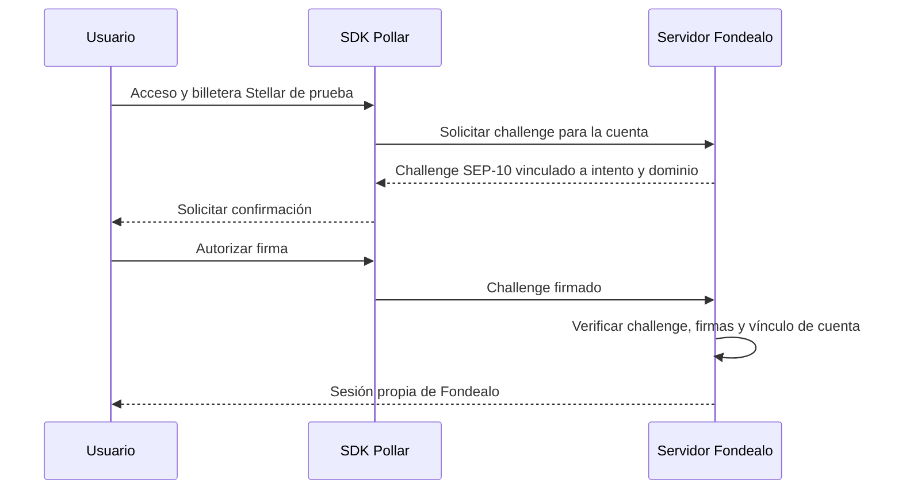

# RFC: evaluar Pollar para acceso y billeteras Stellar

**Estado:** exploración; no se ha sustituido Privy ni habilitado Pollar en la aplicación.
**Fecha:** 2026-10-25.

Pollar es un candidato para concentrar acceso, billetera y firma Stellar. La recomendación es probar su integración nativa en Testnet con usuarios sintéticos y mantener el acceso actual hasta demostrar continuidad de identidad y sesión del servidor. La afinidad con Stellar y Latinoamérica es un motivo para evaluarlo; no prueba disponibilidad en Perú ni equivalencia con Privy.

## Evidencia revisada

Se consultaron npm y el [repositorio público de Pollar](https://github.com/pollar-xyz/pollar/tree/bf7c6e46e823fe1e2063d45519689c7b156ada67). La web `www.pollar.xyz` respondió con un bloqueo HTTP 403 del proxy de este entorno; no se verificaron su panel, precios ni servicio autenticado.

| Tema | Evidencia | Consecuencia para Fondealo |
| --- | --- | --- |
| SDK web | `@pollar/core@0.12.0` y `@pollar/react@0.12.0`, Node >=20 y React >=18 | Encajan con las versiones instaladas de Node 22 y React 19; esto no demuestra integración completa con Next.js |
| Acceso | El SDK documenta correo OTP, Google, GitHub y wallets externas | Permite explorar un ingreso por correo; requiere una aplicación configurada y validar el flujo real |
| Stellar | Firma de XDR, envío, patrocinio de comisiones y pruebas SEP-10/SEP-53 | Puede sustituir la capa de billetera; hay que verificar red, patrocinio y operaciones Soroban específicas |
| Sesiones | Tokens ligados a DPoP y claves del dispositivo | No se puede reutilizar directamente el intercambio de tokens de Privy ni confiar en el estado React como autorización |
| Custodia | Modos internos, externos, smart y opciones Turnkey documentadas | Elegir y verificar un modo concreto; no describir todas las billeteras como autocustodia |
| Latinoamérica | Hay documentación de proveedores y rutas regionales; las condiciones dependen del corredor | No se confirmó una ruta Perú/PEN, disponibilidad comercial ni liquidación para Fondealo |
| Adaptador Privy | El último publicado es `@pollar/privy-adapter@0.11.1`; su rango de core es `^0.11.1` y el de Stellar SDK es `^15.1.0` | No mezclarlo con core 0.12.0 ni asumir compatibilidad con el SDK Stellar 16 de Fondealo |

La [guía de actualización](https://github.com/pollar-xyz/pollar/blob/bf7c6e46e823fe1e2063d45519689c7b156ada67/UPGRADE.md) confirma que el adaptador Privy publicado no acepta core 0.12.0. La rama del repositorio contiene un adaptador candidato, pero no equivale a una versión estable publicada. No forzar las dependencias para convertirlo en un puente de producción.

## Qué debe cambiar en Fondealo

| Pieza actual | Trabajo propuesto |
| --- | --- |
| `apps/web/src/components/privy-providers.tsx` | Proveedor Pollar limitado al piloto; mantener la landing y su lista de espera independientes del proveedor de acceso |
| `apps/web/src/hooks/use-stellar-wallet.ts` | Adaptar sesión, selección explícita de Stellar y estados de creación de cuenta; login correcto no implica cuenta lista ni trustlines disponibles |
| `apps/web/src/components/session-sync.tsx`, `src/lib/actions/session.ts` y `src/lib/auth/session.ts` | Crear una sesión Fondealo verificada por el servidor; definir renovación, expiración y cierre de ambas sesiones |
| `UserWallet.privyUserId` y búsqueda de empresas por dirección | Identidad interna estable, identidades externas por proveedor y vínculos de billetera; migración aditiva antes de incorporar cuentas existentes |
| Campos de auditoría `actorPrivyUserId` | Conservar la historia y añadir identidad interna/proveedor para eventos nuevos; no sustituir identificadores históricos por IDs Pollar |
| `packages/sdk/src/stellar-tx.ts` | Adaptador para XDR firmado/enviado por Pollar; no pasar un envelope a la función que espera una firma Ed25519 en hexadecimal |
| `/business/datos` y lectura del correo | Actualizar proveedor y tratamiento real de datos después de verificar su contrato; no confiar en un perfil enviado por el navegador |
| Administración | Evaluación separada: hoy usa fixtures y su autenticación operativa sigue pendiente. Un login Pollar de cliente no concede permisos de personal |

Los helpers de firma existentes en el SDK no demuestran que la aplicación ya liquide operaciones on-chain. El ledger de prueba y las puertas de KYB/underwriting permanecen bajo autoridad de Fondealo. El KYC que un proveedor de rampas solicite a una persona no verifica su empresa ni aprueba financiamiento.

## Sesión del servidor: primer punto que demostrar

No se encontró en el material revisado un verificador de sesión para el backend de Fondealo equivalente a `PrivyClient.verifyAuthToken`. Su existencia y contrato deben confirmarse con Pollar; no se presupone un endpoint JWKS ni una API de introspección.

Una alternativa documentada para el piloto es la prueba de control de una cuenta clásica Stellar mediante `client.stellar.sep10.sign(...)`:



El servidor debe verificar el challenge exacto emitido, el nonce de un solo uso, vigencia, dominio, red y firmantes/umbrales autorizados de la cuenta. Debe vincular el intento al navegador que lo inició y prevenir login CSRF. El challenge no se envía a la red. La cookie propia debe tener expiración, `HttpOnly`, `Secure` en HTTPS y una política `SameSite` apropiada.

Esta alternativa autentica control de una cuenta, **no** demuestra correo verificado ni un ID de usuario Pollar. La migración y recuperación deben respetar esa diferencia. La documentación indica que estos métodos de prueba no cubren las smart wallets con dirección `C…`; el primer piloto se limita a cuentas clásicas `G…`.

## Prototipo de interfaz y comprobación local

Se instalaron los paquetes publicados en un directorio temporal fuera de Fondealo, con scripts de instalación desactivados. Se comprobaron imports en Node 22 y compilación TypeScript estricta con React/React DOM 19.2.8 y TypeScript 5.9.3. El siguiente proveedor y las llamadas tipadas a `client.stellar.sep10.sign(...)` y `client.signAndSubmitTx(unsignedXdr)` compilaron:

```tsx
'use client';

import type { ReactNode } from 'react';
import { PollarProvider } from '@pollar/react';

export function PilotProvider({ apiKey, children }: { apiKey: string; children: ReactNode }) {
  return (
    <PollarProvider client={{ apiKey, stellarNetwork: 'testnet', confirmation: 'prompt' }}>
      {children}
    </PollarProvider>
  );
}
```

El `apiKey` es un parámetro, no una credencial de ejemplo. Antes de exponerlo al navegador debe confirmarse que sea la clave pública de la aplicación con restricciones de origen. No se ejecutaron login, recuperación, firma, envío ni llamadas autenticadas; tampoco se validó un build Next.js con Pollar. No se añadieron dependencias ni configuraciones Pollar al runtime de Fondealo.

## Piloto y criterio de migración

1. Crear una aplicación de desarrollo Pollar, limitarla a Stellar Testnet y confirmar métodos de ingreso, dominio de retorno, modo de custodia, recuperación y presupuesto de patrocinio. Registrar solo los destinos de red y variables realmente necesarios. El origen API documentado es `https://sdk.api.pollar.xyz`; core 0.12.0 añade `/v3`.
2. Implementar un proveedor seleccionable para cuentas sintéticas nuevas y demostrar la sesión del servidor. Probar recarga, expiración, logout, cierre de otra pestaña, cuenta todavía creándose y rechazo de firmas/direcciones manipuladas, challenges repetidos y acceso al rol incorrecto.
3. Construir una transacción Stellar de prueba con el SDK existente; verificar firma, red, límites, fee bump si corresponde, rechazo del usuario y resultado final en RPC. Probar por separado una operación Soroban representativa antes de habilitar escrituras del producto.
4. Diseñar la vinculación de usuarios existentes: exigir prueba de la cuenta original y de la nueva, conservar el ID interno y rol, y resolver empresas, obligaciones y auditoría asociadas a la dirección anterior. No unir cuentas por coincidencia de correo ni asumir que una nueva billetera hereda la anterior. No exportar claves como requisito de exploración.
5. Evaluar rutas fiat como una fase independiente: país, moneda, dirección, activo/red final, requisitos, proveedor, tarifas y resultado reconciliado. No anunciar Perú/PEN, pagos locales ni acceso a capital a partir de una capacidad genérica del SDK.

Migrar solo cuando el piloto demuestre continuidad de cuentas y controles del servidor, se hayan confirmado las condiciones operativas y exista una vuelta atrás por cohorte. Hasta entonces Privy sigue atendiendo el flujo actual. Las dos opciones operarán como proveedores de acceso; permisos, revisión de empresas y decisiones siguen en Fondealo.

## Fuentes

- [Pollar Core 0.12.0 publicado](https://www.npmjs.com/package/@pollar/core/v/0.12.0) y [React 0.12.0](https://www.npmjs.com/package/@pollar/react/v/0.12.0).
- [Core: autenticación, firma, pruebas Stellar y rampas](https://github.com/pollar-xyz/pollar/blob/bf7c6e46e823fe1e2063d45519689c7b156ada67/packages/core/README.md).
- [React: proveedor y hooks](https://github.com/pollar-xyz/pollar/blob/bf7c6e46e823fe1e2063d45519689c7b156ada67/packages/react/README.md).
- [Adaptador Privy 0.11.1 publicado](https://www.npmjs.com/package/@pollar/privy-adapter/v/0.11.1) y [guía de versiones](https://github.com/pollar-xyz/pollar/blob/bf7c6e46e823fe1e2063d45519689c7b156ada67/UPGRADE.md).
- [Diseño regional de rampas y límites de la evidencia](https://github.com/pollar-xyz/pollar/blob/bf7c6e46e823fe1e2063d45519689c7b156ada67/docs/adr/0001-ramp-api-and-lifecycle.md).
